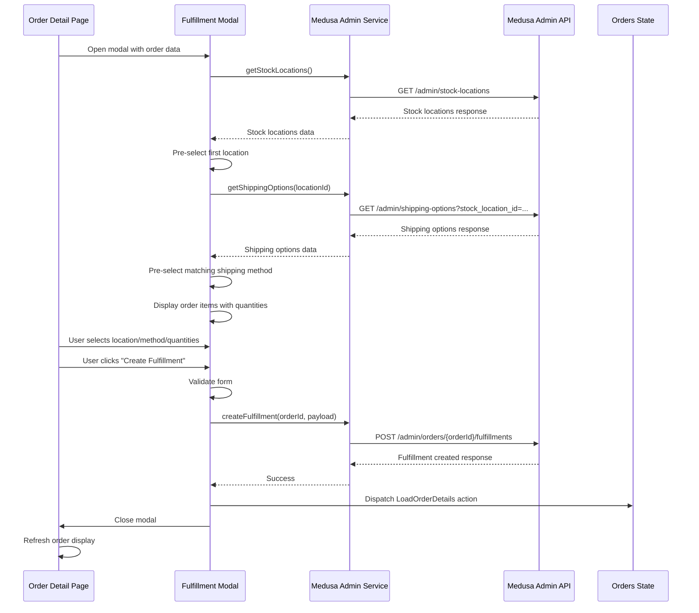

# Design Document

## Overview

The Order Fulfillment Modal is an Angular component that provides a user interface for store staff to create fulfillments for orders. The modal integrates with the existing order detail page and leverages the Medusa Admin API service to fetch stock locations, shipping options, and create fulfillments. The design follows the existing modal pattern used in the application (similar to the driver assignment modal) and maintains consistency with Ionic UI components.

## Architecture

### Component Structure

```
FulfillmentModalComponent
├── Template (fulfillment-modal.component.html)
├── Styles (fulfillment-modal.component.scss)
└── Component Logic (fulfillment-modal.component.ts)
```

### Service Integration

The modal will integrate with:
- **MedusaAdminService**: For API calls to fetch stock locations, shipping options, and create fulfillments
- **OrdersState (NGXS)**: To refresh order data after successful fulfillment creation
- **ModalController (Ionic)**: To manage modal lifecycle

### Data Flow



## Components and Interfaces

### FulfillmentModalComponent

**Location**: `src/app/pages/order-detail/modal/fulfillment-modal.component.ts`

**Inputs**:
- `order`: The complete order object containing items, shipping methods, and order details

**Component Properties**:
```typescript
export class FulfillmentModalComponent implements OnInit {
  order: any; // Passed via modal params
  stockLocations: StockLocation[] = [];
  shippingOptions: ShippingOption[] = [];
  selectedLocationId: string = '';
  selectedShippingOptionId: string = '';
  fulfillmentItems: FulfillmentItem[] = [];
  isLoading: boolean = false;
  isSubmitting: boolean = false;
  errorMessage: string = '';
}
```

**Key Methods**:
- `ngOnInit()`: Initialize modal, load stock locations
- `loadStockLocations()`: Fetch available stock locations from API
- `onLocationChange(locationId: string)`: Handle location selection, load shipping options
- `loadShippingOptions(locationId: string)`: Fetch shipping options for selected location
- `onQuantityChange(itemId: string, quantity: number)`: Update item quantity
- `validateForm()`: Validate location, shipping option, and item quantities
- `createFulfillment()`: Submit fulfillment creation request
- `dismiss()`: Close modal without changes

### Data Interfaces

**StockLocation Interface**:
```typescript
interface StockLocation {
  id: string;
  name: string;
  address: {
    id: string;
    address_1: string;
    city: string;
    country_code: string;
    postal_code: string | null;
  };
  metadata: any;
  created_at: string;
  updated_at: string;
}
```

**ShippingOption Interface**:
```typescript
interface ShippingOption {
  id: string;
  name: string;
  price_type: string;
  provider_id: string;
  service_zone_id: string;
  service_zone: {
    id: string;
    name: string;
    fulfillment_set: {
      id: string;
      location: {
        id: string;
      };
    };
  };
  type: {
    id: string;
    label: string;
    description: string;
    code: string;
  };
  prices: Array<{
    id: string;
    currency_code: string;
    amount: number;
  }>;
}
```

**FulfillmentItem Interface**:
```typescript
interface FulfillmentItem {
  id: string; // order line item id
  title: string;
  subtitle: string;
  thumbnail: string;
  variant_sku: string;
  quantity: number; // selected quantity to fulfill
  availableQuantity: number; // max available
  inStockQuantity: number; // current stock
}
```

**CreateFulfillmentPayload Interface**:
```typescript
interface CreateFulfillmentPayload {
  location_id: string;
  shipping_option_id: string;
  items: Array<{
    id: string;
    quantity: number;
  }>;
}
```

## Data Models

### Stock Locations Response

The API returns stock locations in the following format:
```json
{
  "stock_locations": [
    {
      "id": "sloc_01K9JK9WZWPHEV5ZK65RNDXDWN",
      "name": "European Warehouse",
      "address": {
        "id": "laddr_01K9JK9WZWBARGTNJ7E1FJ1FE6",
        "address_1": "",
        "city": "Copenhagen",
        "country_code": "DK"
      }
    }
  ],
  "count": 1,
  "offset": 0,
  "limit": 10
}
```

### Shipping Options Response

The API returns shipping options with location associations:
```json
{
  "shipping_options": [
    {
      "id": "so_01K9JK9X14C2VPMCTMMSVYHYJ4",
      "name": "Express Shipping",
      "service_zone": {
        "fulfillment_set": {
          "location": {
            "id": "sloc_01K9JK9WZWPHEV5ZK65RNDXDWN"
          }
        }
      },
      "type": {
        "label": "Express",
        "description": "Ship in 24 hours.",
        "code": "express"
      }
    }
  ]
}
```

### Fulfillment Creation Request

```json
{
  "location_id": "sloc_01K9JK9WZWPHEV5ZK65RNDXDWN",
  "shipping_option_id": "so_01K9JK9X14C2VPMCTMMSVYHYJ4",
  "items": [
    {
      "id": "ordli_01K9WY5WZQ2RCPP97TW8V1P926",
      "quantity": 1
    }
  ]
}
```

## Error Handling

### API Error Scenarios

1. **Stock Locations Load Failure**:
   - Display error message: "Failed to load stock locations. Please try again."
   - Disable form submission
   - Provide retry button

2. **Shipping Options Load Failure**:
   - Display error message: "Failed to load shipping options for selected location."
   - Allow location re-selection
   - Provide retry button

3. **Fulfillment Creation Failure**:
   - Display API error message to user
   - Keep modal open with form data intact
   - Allow user to correct and retry

4. **Validation Errors**:
   - Display inline validation messages:
     - "Please select a stock location"
     - "Please select a shipping method"
     - "Please select at least one item to fulfill"
     - "Quantity cannot exceed available stock"

### Network Error Handling

- Implement timeout handling (30 seconds)
- Display user-friendly error messages
- Provide retry mechanisms
- Log errors for debugging

## Testing Strategy

### Unit Tests

1. **Component Initialization**:
   - Test that stock locations are loaded on init
   - Verify first location is pre-selected
   - Verify shipping options are loaded for pre-selected location

2. **Location Selection**:
   - Test that shipping options are reloaded when location changes
   - Verify shipping option dropdown is cleared during reload
   - Test error handling when shipping options fail to load

3. **Quantity Validation**:
   - Test that quantities cannot exceed available stock
   - Test that at least one item must have quantity > 0
   - Test quantity input boundaries (min: 0, max: available)

4. **Form Validation**:
   - Test validation with missing location
   - Test validation with missing shipping option
   - Test validation with no items selected
   - Test validation with valid form data

5. **Fulfillment Creation**:
   - Test successful fulfillment creation
   - Test error handling during creation
   - Test modal dismissal after success
   - Test state refresh after success

### Integration Tests

1. **API Integration**:
   - Test stock locations API call with correct parameters
   - Test shipping options API call with location filter
   - Test fulfillment creation API call with correct payload
   - Test error responses from API

2. **Modal Lifecycle**:
   - Test modal opening with order data
   - Test modal closing on cancel
   - Test modal closing on successful creation
   - Test ESC key dismissal

3. **State Management**:
   - Test order state refresh after fulfillment creation
   - Test order detail page updates after modal closes

### Manual Testing Checklist

- [ ] Modal opens correctly from order detail page
- [ ] Stock locations load and display properly
- [ ] Location dropdown is functional
- [ ] Shipping options load when location is selected
- [ ] Shipping method dropdown displays correct options
- [ ] Order items display with correct information
- [ ] Quantity inputs work correctly
- [ ] Quantity validation prevents invalid values
- [ ] Form validation displays appropriate messages
- [ ] Create Fulfillment button is disabled during submission
- [ ] Success creates fulfillment and closes modal
- [ ] Error messages display correctly
- [ ] Cancel button closes modal without changes
- [ ] ESC key closes modal
- [ ] Order detail page refreshes after fulfillment creation

## UI/UX Considerations

### Modal Layout

The modal follows the Ionic modal pattern with three sections:

1. **Header**:
   - Title: "Create Fulfillment"
   - Close button (X icon)

2. **Content** (scrollable):
   - Location selector (ion-select)
   - Shipping method selector (ion-select)
   - Items to fulfill section:
     - Item cards with thumbnail, title, variant
     - Available/In-stock quantities
     - Quantity input (ion-input with type="number")

3. **Footer**:
   - Cancel button (secondary)
   - Create Fulfillment button (primary)

### Responsive Design

- Modal adapts to mobile and tablet screens
- Dropdowns use native selectors on mobile
- Item cards stack vertically on small screens
- Buttons are touch-friendly (minimum 44px height)

### Loading States

- Display spinner while loading stock locations
- Display spinner while loading shipping options
- Disable form during submission
- Show loading indicator on submit button

### Accessibility

- Proper ARIA labels for form controls
- Keyboard navigation support
- Screen reader announcements for errors
- Focus management (focus first input on open)
- Color contrast compliance

## Service Layer Updates

### MedusaAdminService Extensions

Add the following methods to `src/app/shared/api/medusa.service.admin.ts`:

```typescript
/**
 * Get stock locations with pagination
 */
getStockLocations(limit: number = 10, offset: number = 0): Observable<any> {
  return this.get(`/admin/stock-locations`, { limit, offset });
}

/**
 * Get shipping options, optionally filtered by stock location
 */
getShippingOptions(params?: {
  stock_location_id?: string;
  fields?: string;
  limit?: number;
  offset?: number;
}): Observable<any> {
  return this.get(`/admin/shipping-options`, params);
}

/**
 * Create fulfillment for an order
 */
createFulfillment(orderId: string, payload: CreateFulfillmentPayload): Observable<any> {
  return this.post(`/admin/orders/${orderId}/fulfillments`, payload);
}
```

## Integration with Existing Code

### Order Detail Page Integration

The fulfillment modal will be triggered from the order detail page, similar to the driver assignment modal:

**Location**: `src/app/pages/order-detail/order-detail.page.ts`

Add method:
```typescript
async openFulfillmentModal() {
  const modal = await this.modalController.create({
    component: FulfillmentModalComponent,
    componentProps: {
      order: this.order
    }
  });

  await modal.present();
  
  const { data } = await modal.onWillDismiss();
  if (data?.success) {
    // Refresh order details
    this.store.dispatch(new LoadOrderDetails(this.order.id));
  }
}
```

### State Management

After successful fulfillment creation, dispatch the existing `LoadOrderDetails` action to refresh the order:

```typescript
this.store.dispatch(new LoadOrderDetails(orderId));
```

This ensures the order detail page displays the updated fulfillment information.

## Performance Considerations

1. **Lazy Loading**: Modal component should be lazy-loaded to reduce initial bundle size
2. **Caching**: Consider caching stock locations if they don't change frequently
3. **Debouncing**: Debounce quantity input changes to prevent excessive validation
4. **Pagination**: Implement pagination for stock locations if there are many locations
5. **Optimistic Updates**: Consider optimistic UI updates for better perceived performance

## Security Considerations

1. **Authentication**: All API calls require valid authentication token (handled by existing interceptor)
2. **Authorization**: Verify user has permission to create fulfillments (backend validation)
3. **Input Validation**: Validate all user inputs before submission
4. **XSS Prevention**: Sanitize any user-generated content displayed in modal
5. **CSRF Protection**: Ensure CSRF tokens are included in POST requests (if applicable)
